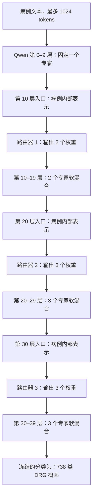

# 最新 OpenJEV–MoE–LoRA 完整方法（通俗说明）

版本日期：2026-10-27。依据当前运行目录 `batch_nll_mlp_openjev_1233_1024_20261027` 的配置、冻结源码、preflight 与训练记录撰写。

**本文只描述当前正在训练的模型；本轮尚无最终验证结果，不收录旧实验成绩。**

## 1. 我们要解决什么问题

输入是一份住院病例文本，输出是 738 个 DRG 类别的概率，以及最可能的类别。DRG 可以理解为按诊断、操作及病情等信息划分的病例组。

一个普通模型对所有病例使用同一套计算方式。本模型在大模型的不同深度配置多个小型 LoRA 专家，让不同病例采用不同的专家组合。OpenJEV 的工作是读取病例在当前深度的内部表示，决定各个专家应占多大权重；最终 DRG 类别仍由 Qwen3-14B 专家骨干与分类头产生。

可以把系统理解为两部分：**专家负责处理病例，路由器负责分配专家权重。** 当前研究的核心是：在同一个已训练专家池上，OpenJEV 路由器能否比简单 MLP 路由器更好地完成分配。

## 2. 总体结构

上图中的三个路由器可以全部采用 MLP，也可以全部采用 OpenJEV，两种策略分别训练和评价。OpenJEV 三个路由器共享一个冻结的 1.7B decoder，保留各自独立的可训练小组件。

四个 block 的层号均从 0 开始；每块固定 10 层，专家数为 `[1,2,3,3]`。第一块只有一个专家，动作恒为 0，因此只训练后三块的路由器。

## 3. 数据、切分和“batch”的含义

沿用固定切分与 seed `20260718`：

| 划分 | 病例数 | 本轮用途 |
|---|---:|---|
| train | 212553 | 生成监督标签和训练路由器 |
| validation | 23617 | 完整策略选模、报告开发成绩及离线路由诊断 |
| 历史 new_test | 26242 | 最新实验不读取；它曾在更早实验中被用于开发 |

当前 train/validation 来自 `new_train.csv` 的 90%/10% 划分；不能沿用旧实验“全量 new_train 训练、new_test 验证”的描述。实体隔离依据记录为 one-row-per-admission 来源约定及重复文本审计，并没有可直接使用的 patient identity 列，因此不能声称已证明严格的跨患者独立性。

这里要区分三个层面的 batch：

1. **监督逻辑批 train16**：按固定行序，每 16 例为一组。共 13285 批，尾批 9 例。它决定训练标签。
2. **路由器优化批**：当前同样每次使用一个完整 train16 逻辑批。只打乱批顺序，不打乱成员。
3. **计算微批**：隐藏特征提取、oracle 重算及验证以 8 例计算，降低显存使用。它不会把当前模型变成“8 例共享一个预测权重”。

验证按固定 batch8 组织，共 2953 批，尾批 1 例。验证 oracle 以这些批为单位定义，bootstrap 也以这些批为单位重采样。

**当前监督标签来自整个批，但模型输出是逐病例的。** 同批病例训练时可能得到相同目标动作，预测时仍可获得不同权重。

## 4. 专家池是什么，来自哪里

### 4.1 冻结的大骨干与小专家

病例骨干为 Qwen3-14B，40 个 decoder 层，隐藏维数 5120。输入最多保留 1024 tokens。当前加载方式使用 NF4 四位量化与 BF16 计算，LoRA 参数保持相应训练精度。

在注意力的 `q_proj/k_proj/v_proj/o_proj` 上加入共享与私有 LoRA。共享部分由该层所有路线共用，私有部分按专家编号区分。共享/私有 rank 分别为 4/4，alpha=16，源专家训练 dropout=0.05；冻结推理时关闭 dropout。

对某层投影、某病例的隐藏输入 h，可写为：

\[
y=W_0h+\Delta W_{shared}h+\sum_{k=0}^{K_b-1}\pi_{i,b,k}\Delta W_{b,k}h.
\]

`W0` 是大模型原始权重；两个增量是小型低秩变换。权重 `π` 对每个病例、每个 block 单独计算，并在该 block 的全部 10 层及四类投影中复用。代码对每个 LoRA 分支使用 `alpha/rank` 缩放。

这相当于“共享的基础处理能力，加上几种专门处理方式的加权组合”。私有专家编号只是训练分组编号，不能直接命名成“外科专家”“重症专家”等医学语义。

### 4.2 专家最初如何分工

源实验先从训练数据提取梯度签名：固定探针 LoRA-A、LoRA-B 初始化为 0；用真实 DRG 标签计算平均梯度，并收集输入的二阶统计量。探针 rank=8、alpha=8，ridge=0.001。

直观上，两个批如果对参数提出相近、可兼容的更新要求，就更适合由相同专家处理。实现采用 metric-aware compatibility：考虑梯度方向，也考虑不同方向上的输入尺度。对每层的兼容性分数先对称化、按非对角元素标准化，再将该 block 的全部层等权融合，然后做谱聚类。

源专家阶段使用 signature batch16 的聚类标签，并把一个批的标签复制给成员病例来训练共享/私有 LoRA 与 DRG 分类头。随后源实验进行可微软路由的联合训练，更新专家、分类头及源 MLP。源联合配置为 3 epochs、有效 batch16、专家学习率 1e-5、分类头 5e-5、router 1e-4、负载均衡系数 0.001，按验证 Top1 选 checkpoint。

**当前复用的是源联合训练第 25285 步选中的专家与分类头，不只是最初聚类训练后的权重。** 源目录为 `k1233_qwen1024_train16_eval8_sig16_8gpu_20261022`。最新 router 实验不重新训练这些专家；也不使用源 MLP 的参数作为新路由器初始化。

梯度分组解释了专家的历史来源。最新路由器的监督标签则完全由最终 DRG NLL 定义。上游已清理 raw gradient signatures；仓库没有把不存在的原始缓存写成已保存产物。

## 5. OpenJEV 初始化怎样获得

本项目的 OpenJEV 指本地可训练的 OpenJEV-RLCD 实现。基础模型是 `Qwen/Qwen3-1.7B`，revision 为 `70d244cc86ccca08cf5af4e1e306ecf908b1ad5e`；采用作者提交 `22db40ad3333f5cf0bc5139097da70e0f8c05018` 的原始训练目标。

先在 MMLU-Pro 上做通用 O1/O2 初始化，得到 O2 checkpoint，再把其 decoder 用作 DRG 路由器底座。MMLU-Pro revision 固定为 `b189ec765aa7ed75c8acfea42df31fdae71f97be`，按作者约定的 seed=0 切成 4000/500/1500 个问题，另保留剩余 pool。

| 初始化设置 | 实际值 |
|---|---|
| O1 / O2 | 各 400 步 |
| 每步问题 / 每题 rationale | 8 / 4 |
| 学习率 | 2e-6 |
| 最大生成长度 | 256 |
| O1 | seed=17，关闭 score-function 项 |
| O2 | seed=1017，从 O1 开始；score-function 系数 0.3，KL 系数 0.04 |
| 读出评分 | per-rationale Brier |

这些阶段学习通用的概率决策行为，并不直接学习 DRG。进入最新 DRG 实验后，O2 原始 decoder 参数冻结，只训练桥接、q/v LoRA 与动作头。这里不能把“通用初始化具有校准目标”直接推导成“DRG 路由概率已经校准良好”。

本方法不调用官方 Jev API；历史双路径文档中的官方 API 路线没有参与这轮实验。

## 6. 路由器到底看什么

对于病例 i，在 block b 开始执行前，取当前入口的 token 隐藏状态，仅对 attention mask 有效的 token 求均值：

\[
z_{i,b}=\frac{\sum_t m_{i,t}h_{i,t,b}}{\max(1,\sum_t m_{i,t})}\in\mathbb R^{5120}.
\]

这个向量概括了“病例经过此前各层处理后，当前模型理解到了什么”。它不含真实 DRG 标签，不计算测试标签梯度，也不直接输入 oracle 答案。

目前没有跨病例的 mean/std 集合编码，也没有把其他病例的向量一起送进某个病例的路由器。上游 block 的软混合会改变下游入口向量，因此下游决策自然依赖此前的计算；当前实现没有额外拼接离散 prefix 编码。

### 6.1 简单 MLP 对照

每个 active block 独立使用：

`LayerNorm(5120) → Linear(5120,32) → SiLU → Linear(32,Kb) → softmax`。

末层零初始化，使初始分布均匀。三个路由器共 522600 个可训练参数。

### 6.2 OpenJEV 路由器

每个 block 配置以下可训练组件：

1. bridge：`LayerNorm(5120) → Linear(5120,128) → SiLU → Linear(128,4×d)`；
2. 将 bridge 输出 reshape 为 4 个连续向量，作为 OpenJEV 的软输入 token；
3. 在末尾加一个可训练 decision embedding，共 5 个输入位置；
4. 使用该 block 独立的 q/v LoRA 运行共享冻结 decoder；
5. 取最后一个位置的 hidden state，经该 block 的输出头产生 2 或 3 个动作分数，再 softmax。

`d` 为 OpenJEV decoder 的隐藏维数。这个桥接是可学习的数值映射，使用 `inputs_embeds`，并没有把 5120 维浮点数转成自然语言 prompt。它不要求 Qwen3-14B 与 OpenJEV 原始 embedding 空间天然一致。

q/v LoRA rank=8、alpha=16、dropout=0.05；三个 block 的 bridge、decision embedding、LoRA 和动作头独立，共 10006920 个适配参数。decoder 主参数共享且冻结。

当前路由器在推理时仅处理 5 个连续输入位置，不生成 rationale，也不通过语言模型原始词表头选择字母答案。

## 7. 最新监督：固定批的 DRG NLL 最优路线

### 7.1 完整硬路线

定义硬路线为四个 block 的专家编号：

\[
r=(0,a_1,a_2,a_3),\quad a_1\in\{0,1\},\;a_2,a_3\in\{0,1,2\}.
\]

共有 `1×2×3×3=18` 条。固定专家池后，把每个病例沿每条硬路线执行一遍，得到最终 DRG 分类概率。对真实类别 y 的损失是负对数似然：

\[
\ell_i(r)=-\log P(y_i\mid x_i,r).
\]

如果模型给真实类别的概率更高，NLL 更小。例如真实类别概率为 0.8 时，损失约 0.223；概率为 0.2 时，损失约 1.609。它同时考虑是否正确和概率的合理性，比只看某个中间专家编号更直接。

### 7.2 先求批均值，再选路线

对固定 train16 批 S：

\[
L_S(r)=\frac1{|S|}\sum_{i\in S}\ell_i(r),\qquad
r_S^*=\arg\min_{r\in\mathcal R}L_S(r).
\]

精确并列时选择字典序较小的完整路线。当前均值用 FP64 累加，保留底层 FP32 病例损失。再把该路线三个分量复制给批内所有病例：`t[i,b]=r*[S,b]`。

例如，批 S 的最低平均损失路线是 `(0,1,2,0)`，那么该批 16 例在 block1 的目标均为 1，在 block2 均为 2，在 block3 均为 0。但每个病例仍独立输出 softmax，最终预测分布并不强制一致。

**这是整个批的平均最终 DRG 损失所选的完整路线，不是逐病例最优路线、梯度聚类标签或“单独把某一层换成哪个专家最好”。** 一个病例的个人最优路线可能与本批目标不同。

### 7.3 复用和重算的边界

本轮复用上一轮已完整计算的每病例 18 路原始 NLL，重新按固定 train16 聚合；不复用旧逐病例最优动作、soft targets、旧隐藏特征或旧 router 参数。

3322 个代价分块已核对成员、真实标签、来源合约、完整覆盖、张量形状、有限值和 SHA256。首批 16 例以实际模型重算全部 18 路，验证误差为 0。专家、输入截断及计算微批保持一致，因此这些原始代价可以重新聚合为当前监督。

这些损失表包含病例级信息，保留在本地；仓库发布聚合清单与核验记录。

## 8. 两个训练阶段

两种路由器都从新的 DRG 适配参数开始，使用同一批标签、病例数和训练轮数。当前仅一个 seed=`20260718`。

### 8.1 阶段一：最优硬前缀下训练 3 轮

先沿本批 oracle 最优硬路线执行冻结专家池，重新提取各 block 的病例入口向量。每个 block 的路由器分别训练 3 轮，用交叉熵预测复制到病例的目标动作：

\[
\mathcal L_b=\frac1N\sum_S\sum_{i\in S}-\log\pi_b(r_{S,b}^*\mid z_{i,b}).
\]

训练时均匀随机选择逻辑批。代码中的单步损失为 `sum(case CE) × (B/N)`，B=13285，N=212553，使尾批按真实 9 例计权，而不是让尾批与 16 例批贡献相同总权重。

这里 oracle 只用于训练侧构造监督和前缀。部署阶段无法知道最优硬路线，所以还需让下游路由器适应实际预测的入口表示。

### 8.2 阶段二：实际软前缀下顺序训练 2 轮

按 block1 → block2 → block3 的顺序：

1. 冻结已经完成的上游 router；
2. 用真实预测的逐病例软混合执行上游 block；
3. 重新提取当前 block 的入口向量；
4. 当前 router 继续训练 2 轮相同交叉熵。

block1 的上游只有固定 block0，因此可精确复用阶段一的入口特征。block2/3 分别为 MLP 与 OpenJEV 重建实际前缀特征；缓存绑定合约、成员位置及上游 checkpoint hash。

**第二阶段更新特征，但不改变标签。** 标签始终是固定批的全局最优完整硬路线分量。它不是旧 Methods 中“按实际硬前缀重新计算条件最优动作”的 R-B；本文将它称为实际软前缀训练，避免混淆。

### 8.3 优化设置与公平性范围

| 设置 | MLP | OpenJEV |
|---|---:|---:|
| 隐藏/bridge 宽度 | 32 | 128 |
| 可训练适配参数 | 522600 | 10006920 |
| 主学习率 | 1e-5 | bridge/head 1e-4 |
| q/v LoRA 学习率 | — | 1e-5 |
| 优化批 | 固定 train16 | 固定 train16 |
| 轮数/每块 | 最优前缀 3 + 实际软前缀 2 | 最优前缀 3 + 实际软前缀 2 |

两者均使用 AdamW、weight decay=0、梯度范数裁剪 1。每 200 步保存恢复状态，并记录优化器和随机数状态。本轮不加 class weight、label smoothing、负载均衡损失或最终 DRG CE 微调。

因此这是“同监督、同数据曝光和同训练轮数”的对照；容量、学习率和计算量不同，不能写成参数量或算力完全匹配的比较。源专家联合训练中的负载均衡正则也不属于本轮 router loss。

## 9. 部署时怎样计算

部署只需要病例文本、固定专家池与训练好的 router：

1. 分词并截断至 1024 tokens；
2. 用 block0 固定专家处理；
3. 计算该病例在 block1 入口的 masked token mean，router 输出两项权重；
4. block1 在各 LoRA 投影上按该权重混合私有专家输出；
5. 在 block2、block3 依次重复，使用 3 项权重；
6. 分类头输出 738 类分数，经 softmax 得到 DRG 概率。

比如某病例在 block2 的权重是 `[0.2,0.5,0.3]`，三个私有专家的增量按 20%/50%/30% 相加。代码实际计算所有私有分支，因此目前是稠密软混合，不是只激活一个分支的 Top1 稀疏推理。

同块不同层共享该病例的权重；下一块会根据更新后的病例表示重新决策。推理不读取真实标签、梯度签名或 oracle。真实标签只在输出完成后供本地 evaluator 计算指标。

18 条硬路线只定义监督搜索空间。连续软混合的可达输出不受这些硬路线输出集合限制，所以不能假定“soft 模型 NLL 减去最佳硬路线 NLL”必定非负。

## 10. 怎样验证与选择模型

每种方法分别评价阶段一和阶段二的完整策略，以 **validation NLL 最小**选择最终模型；不根据 test 选模型。验证 oracle 存放在独立目录，按 batch8 定义，模型前向不读取它。

最终应报告：DRG Top1/Top5/Top10、NLL、macro-F1，各 block 相对验证 batch oracle 的动作准确率、完整动作向量准确率、权重均值、argmax 使用率、熵及两方法配对 bootstrap 差值。bootstrap 2000 次，以固定 validation8 批为重采样单位。

“动作准确率”以病例计数：比较病例 softmax 的 argmax 与本验证批最佳完整硬路线的相应分量；block0 不计入。它不是最终 DRG 准确率，也不是历史兼容性分组命中率。Softmax 权重本身不等于 DRG 预测正确概率。

当前审计代码的 DRG macro-F1 使用 scikit-learn 默认标签集合（真实/预测中出现的类别），没有显式强制传入全部 738 个标签；读者应按此实际口径解释。路由动作 macro-F1 则显式覆盖该 block 的全部动作编号。

这是开发集上的模型选择与比较。单个 seed 和开发集 bootstrap 不等于多 seed 稳健性，也不是未接触测试集的泛化置信区间。历史 new_test 曾被开发使用，这一点不会因当前脚本不访问 test 而消失。

## 11. 当前实验进展

本轮 `batch_nll_mlp_openjev_1233_1024_20261027` 正在训练。导出状态和更新时间见该实验 `records/progress.json`；该文件只是发布时快照。已有 train oracle 完整性核验、首批18路重算和真实模型 preflight。MLP 与 OpenJEV 的适配参数能获得有效梯度，冻结专家与分类头没有变化，固定计算形状下替换同伴病例不会改变当前病例的路由输出。

**当前没有本轮最终验证 Top1/NLL 或优于 MLP 的结论。** 只有最终完成验证与策略选择后，才会填入本轮指标。

## 12. 目前设计的主要限制

- 批内复制同一标签可能让不同个人最优路线的病例受到相同监督。这是本轮选择的目标定义，也正是需要实测的假设。
- 阶段二入口是实际软前缀，标签仍来自全局最优硬路线，两者并不保证严格一致。
- 训练监督批16、验证诊断批8，批组成可能改变 oracle 目标；模型前向逐病例独立并不能消除这种监督依赖。
- O2 为通用任务初始化，迁移到医学隐藏特征后的收益和概率校准必须重新验证。
- OpenJEV 增加约 1.7B 冻结底座和适配计算；本轮不承诺稀疏加速或更低延迟。
- NF4/BF16 改变 GEMM batch 形状可能产生数值差异。本轮固定形状下同伴病例改变误差为 0；这不构成跨微批形状严格逐位等价的证明。
- 本轮还在训练，尚不能判断哪种路由器在当前监督方案下更好。

## 13. 对应实现与复现索引

| 内容 | 实际文件（仓库相对路径） |
|---|---|
| 监督代价重新聚合 | `experiments/batch_nll_20261027/source/prepare_batch_nll.py` |
| 入口向量、bridge、OpenJEV、软混合 | `experiments/batch_nll_20261027/source/soft_openjev_runtime.py` |
| 最新特征、训练与推理 | `experiments/batch_nll_20261027/source/train_batch_nll_routers.py` |
| 验证 oracle | `experiments/batch_nll_20261027/source/batch_nll_oracle.py` |
| 串联与恢复 | `experiments/batch_nll_20261027/source/launch_batch_nll_routers.py` |
| 指标、选模与配对比较 | `experiments/batch_nll_20261027/source/audit_batch_nll_routers.py` |
| 原始配置、合约和状态 | `experiments/batch_nll_20261027/records/` |
| O1/O2 来源 | `initialization/records/`、`vendor/openjev-rlcd/` |

运行步骤见 [REPRODUCIBILITY.md](REPRODUCIBILITY.md)。本文为当前实现的主要方法说明。
